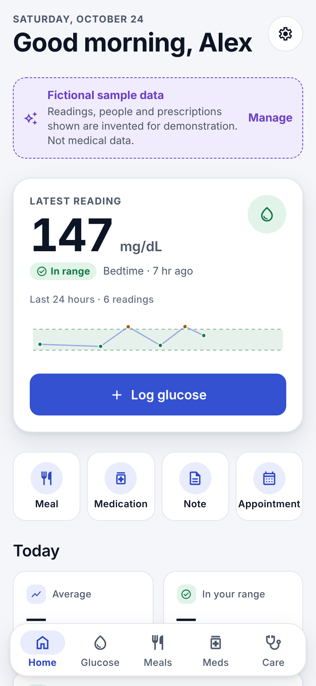
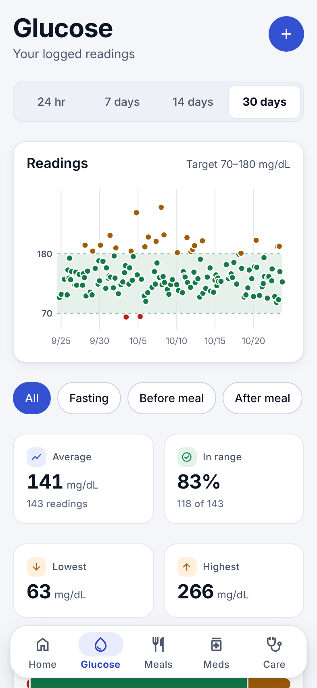
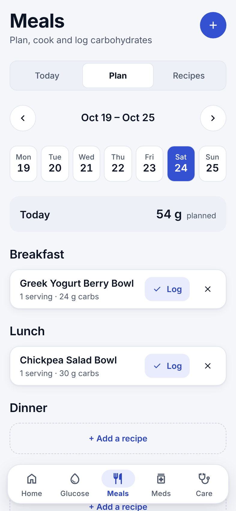
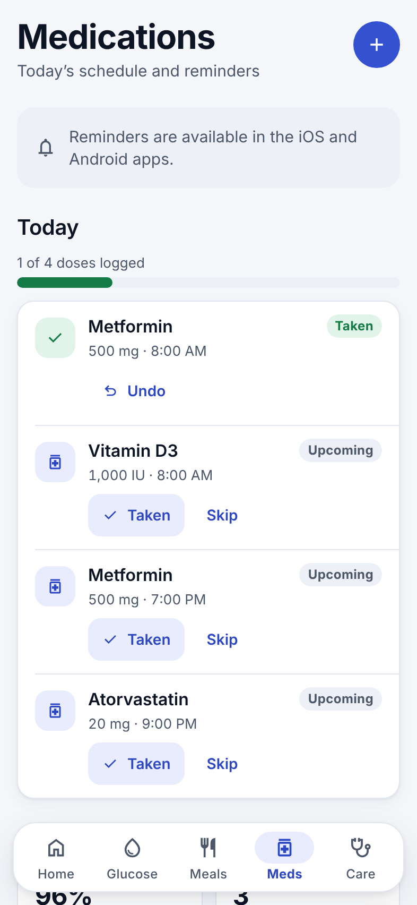
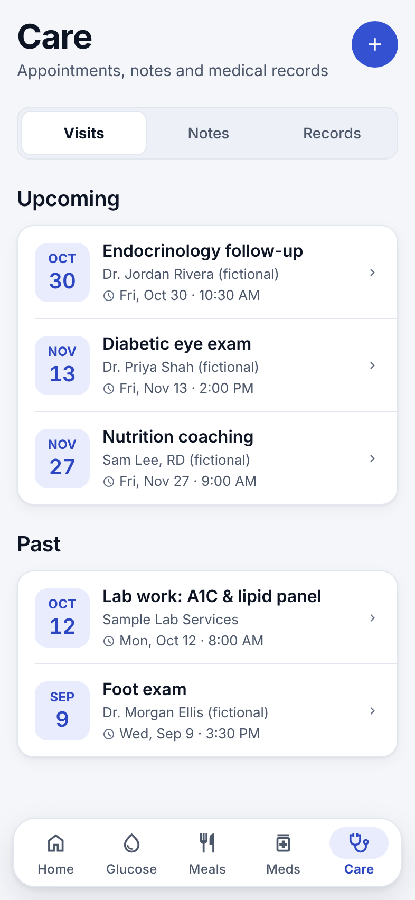
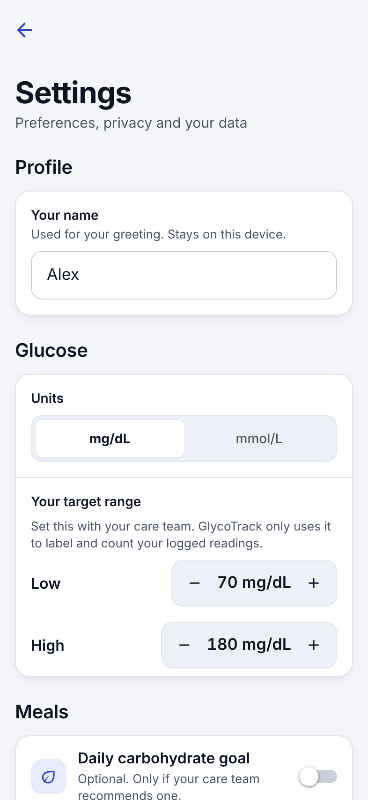
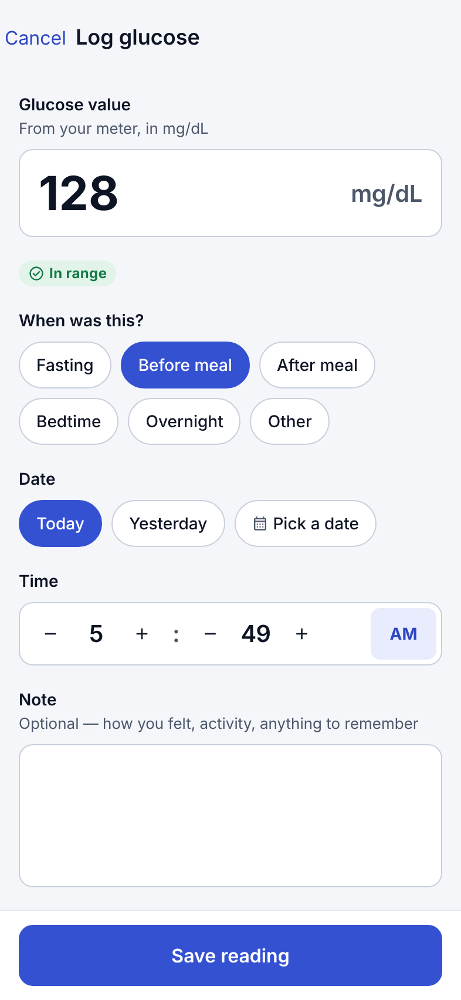
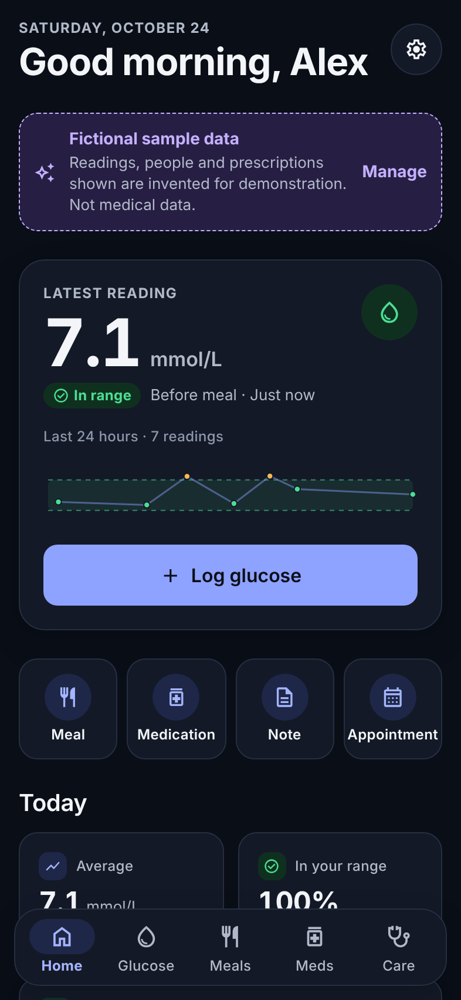

# GlycoTrack

A premium, privacy-first diabetes **logbook and organizer** for iOS and Android: glucose history,
meal planning and carbohydrate tracking, medications and reminders, appointments, medical notes
and records.

> **Status:** Milestone 1 (mobile app with local storage) and Milestone 2 (backend foundation,
> local only) complete. **Not released.** Nothing is deployed. See [`docs/APPROVALS.md`](docs/APPROVALS.md).

> **Safety:** GlycoTrack does not provide medical advice, never calculates insulin or any
> medication dose, and does not monitor glucose or send glucose alarms. See [`docs/SAFETY.md`](docs/SAFETY.md).

| Home | Glucose | Meal plan | Medications |
| --- | --- | --- | --- |
|  |  |  |  |
| **Care** | **Settings & privacy** | **Log a reading** | **Dark mode** |
|  |  |  |  |

All data shown is **fictional sample data**, labelled as such in the app.

## Project layout

```
glycotrack/
├── mobile/   Expo (React Native + TypeScript) app: the product
├── api/      FastAPI + PostgreSQL backend foundation (local dev only, not connected yet)
└── docs/     Architecture, safety, privacy, design, testing, milestones, approvals
```

## Run the app

Requires Node 22+.

```bash
cd mobile
npm install
npx expo start          # press i / a for a simulator, or scan with a development build
npm run check           # typecheck + lint + tests
npm run export:web && npm run e2e   # browser end-to-end + accessibility checks
```

The app uses native modules (notifications, biometrics, native tabs), so on a phone use a
**development build** (`npx expo run:ios|android` or EAS), not Expo Go.

## Run the backend

See [`api/README.md`](api/README.md).

## Documentation

- [Architecture](docs/ARCHITECTURE.md)
- [Safety boundaries](docs/SAFETY.md)
- [Privacy & data handling](docs/PRIVACY.md)
- [Design system & accessibility](docs/DESIGN.md)
- [Testing](docs/TESTING.md)
- [Milestones & progress log](docs/MILESTONES.md)
- [Decisions needing approval](docs/APPROVALS.md)
